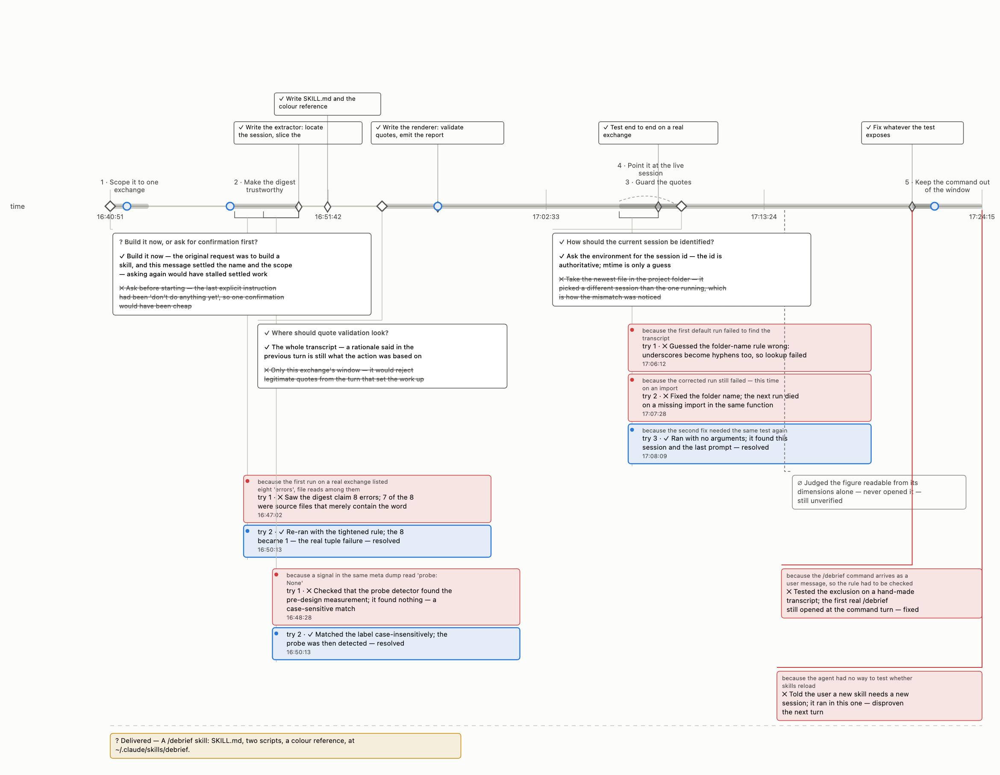
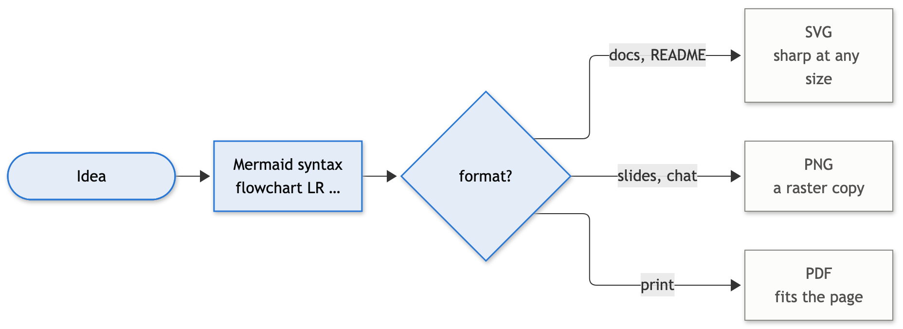
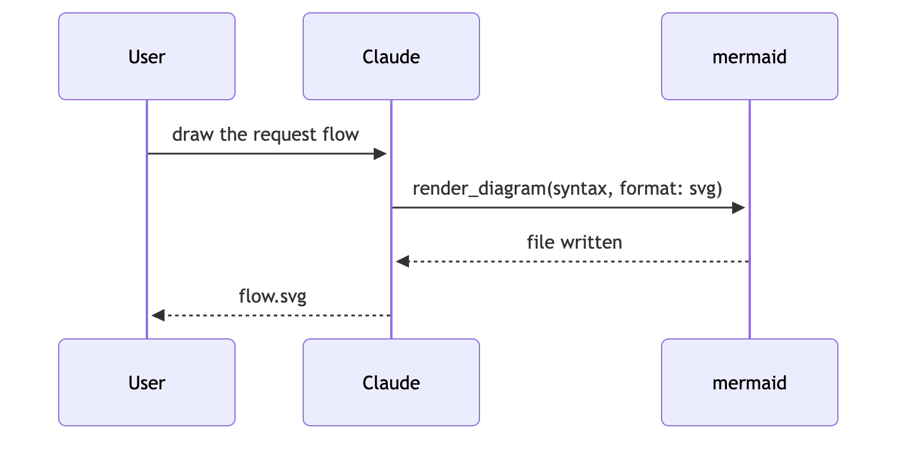

# Claude skills

Two skills I reach for constantly: one reviews what just happened, the other draws what I
am about to explain.

| Skill | What it does | Needs |
|---|---|---|
| [`debrief`](skills/debrief) | Reviews the exchange that just finished — what was asked, what was delivered, where the agent guessed — as a one-page report and a decision-path timeline | Python 3.9+, standard library only |
| [`mermaid`](skills/mermaid) | Draws a diagram as an image rather than a code block, by rendering Mermaid syntax through the `mermaid` MCP server | Node 18+ and `mermaid-render-mcp` |



## debrief

`/debrief` reads the current session's transcript and turns the last exchange into three
files: a `report.md` with what was asked, what was delivered, what was actually checked,
and the decisions phase by phase; a `figure.svg` timeline where position is time, filled
dots are what held, coloured branches are where the work deviated, diamonds are forks
where an option was set aside; and a `figure.mmd` if you want to edit the diagram.

The rule that keeps it honest: every quote in the report is checked against the
transcript, and the render fails if one is not there verbatim.

A worked example ships with the skill, together with the `debrief.json` it was rendered
from: **building this skill** — [report.md](skills/debrief/example/build/report.md) ·
[debrief.json](skills/debrief/example/build/debrief.json). It is the timeline in the
screenshot above: three forks, among them whether to build immediately and how to identify
the current session.

- Design notes: [architecture](skills/debrief/docs/debrief-architecture.svg) ·
  [colour scheme](skills/debrief/reference/colour-scheme.md)
- Optional `--trace` produces `trace.html`, an interactive view of every tool call
  (needs the [trajectory-tree](https://github.com/goatliamia/trajectory-tree) viewer,
  installed outside this repo).

## mermaid

Ask for a diagram and you get a file, not a fenced code block. The skill covers when to
render versus print source, where to write the file, which format to pick, and the
drawing rules that keep a diagram from becoming a wall of boxes.





The renderer itself is a third-party MCP server,
[`mermaid-render-mcp`](https://github.com/tci-nebula/mermaid-mcp) (MIT); this folder holds
the instructions and conventions, not the server. Install it once:

```bash
claude mcp add mermaid -- npx -y mermaid-render-mcp
```

The first run downloads headless Chromium (~150 MB). PNG rendering is currently broken in
the bundled mermaid-cli 12 (it passes a `-w` flag that release removed) — render SVG and
rasterise locally if you need a bitmap.

## Install

```bash
./install.sh
```

This symlinks each folder under `skills/` into `~/.claude/skills/`, so edits in this repo
are live. Set `CLAUDE_SKILLS_DIR` to link somewhere else. A folder that already exists
and is not a symlink is skipped rather than overwritten — if you already have a copy of a
skill installed there, move it aside first (`mv ~/.claude/skills/debrief ~/.claude/skills/debrief.bak`)
so the link can take its place. Then register the MCP server for the mermaid skill as
above.

## Layout

```
skills/
  debrief/      SKILL.md · scripts/ · reference/ · example/build/ · docs/
  mermaid/      SKILL.md · docs/
install.sh
```

## Notes

- `debrief` reads `~/.claude/projects/*/<session>.jsonl`. That format is undocumented and
  changes with Claude Code releases; this is the part of the repo most likely to need
  maintenance.
- The example under `skills/debrief/example/build/` ships its `debrief.json` so the
  rendering inputs are visible; the transcript itself is not committed, and neither is the
  generated 3 MB `trace.html`.
- MIT licensed — see [LICENSE](LICENSE).
