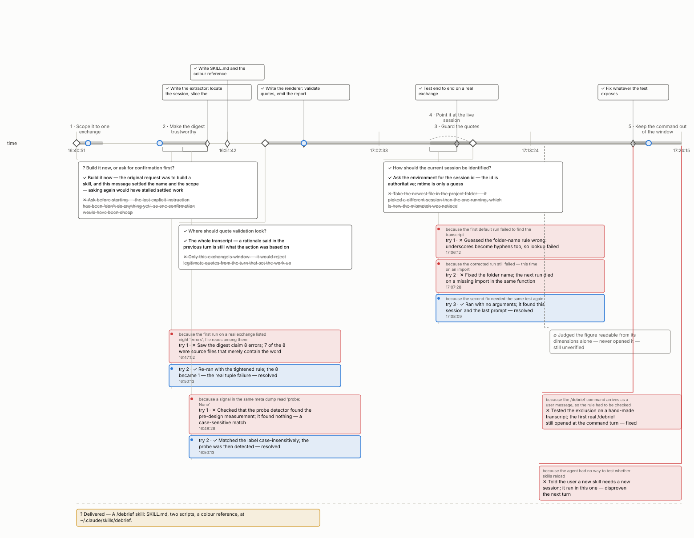

# Building the debrief skill

*16:39:45 → 17:24:15 · 84 tool calls · 3 errors · 62 reasoning blocks*

**Key** — ✓ verified (an observation backs it) · ? assumed (nothing tests it) · ✕ contradicted (an observation disagrees) · ∅ unobserved (no evidence either way)

| | |
|---|---|
| **Asked** | “yeah /debrief sounds more intuitive” … “i think the last exchange only makes more sense” |
| **Goals** | ✓ Write the extractor: locate the session, slice the exchange, emit a digest · 16:50:13 ✓ Write the renderer: validate quotes, emit the report · 16:57:09 ✓ Write SKILL.md and the colour reference · 16:51:40 ✓ Test end to end on a real exchange · 17:08:09 ✓ Fix whatever the test exposes · 17:20:47 |
| **Delivered** | A /debrief skill: SKILL.md, two scripts, a colour reference, at ~/.claude/skills/debrief. |
| **? Checked** | Extract and render ran end to end on two real exchanges, including the quote-rejection path. The skill's own /debrief invocation was never exercised — the first real one, next turn, failed. |

*A goal marked ? was claimed done by the agent but not observed here; ∅ was never attempted; ✕ was abandoned or contradicted.*

Forty-five minutes from a settled scope to a working skill, with five defects caught by running things rather than by reading them. Two claims went out untested: the figure was judged readable on its dimensions alone, and the rule that keeps the /debrief command out of the reviewed window was cleared only against a transcript the agent wrote itself — the first real invocation then reproduced the bug.

*Time runs left to right; dots on the line held, branches are where the work deviated, diamonds are forks where one option was taken and the others set aside. Full claims and evidence are in the tables below.*

## Decisions, phase by phase

### 1. Scope it to one exchange

*Why (inferred) — the user settled the name and the boundary — current session, last exchange — so the build had a fixed contract instead of an open design*

| | Claim | Evidence |
|---|---|---|
| ? | Read the scope reply as a go-ahead to build, though it never said build | the message settled name and boundary; the decision to start building was the agent's own |
| ✓ | ↳ **chose** Build it now — the original request was to build a skill, and this message settled the name and the scope — asking again would have stalled settled work | *inferred* |
| ✕ | ↳ ~~Ask before starting~~ — the last explicit instruction had been 'don't do anything yet', so one confirmation would have been cheap | *inferred* |
| ✓ | Checked how the log marks a typed prompt versus an injected one — 315 versus 21 | counted across transcripts at 16:41:40, so the boundary rule had evidence behind it |

### 2. Make the digest trustworthy

*Why (inferred) — the first real test of the extractor reported eight errors where the exchange had one, and a wrong count here would be copied into every judgement downstream*

| | Claim | Evidence |
|---|---|---|
| | **Make the error signal mean something** | |
| ✕ | *because the first run on a real exchange listed eight 'errors', file reads among them* Saw the digest claim 8 errors; 7 of the 8 were source files that merely contain the word | tightened to tracebacks, bare exception lines and explicit failures — one real error survived |
| ✓ | Re-ran with the tightened rule; the 8 became 1 — the real tuple failure | digest 16:50:13: '1 errors' |
| | **Make the probe detector fire** | |
| ✕ | *because a signal in the same meta dump read 'probe: None'* Checked that the probe detector found the pre-design measurement; it found nothing — a case-sensitive match | the detector looks for a measurement taken before the first edit; it returned nothing until the label match was fixed |
| ✓ | Matched the label case-insensitively; the probe was then detected | meta.json 16:50:13: probe: Probe concurrency tolerance |
| ✓ | Measured the digest at 4.7k tokens for a 37-call exchange | 18,742 bytes at 16:46:50 — small enough to read whole |

### 3. Guard the quotes

*Why (inferred) — the report is only worth reading if a sentence attributed to the agent was actually said, so the renderer refuses to run when a quote does not match*

| | Claim | Evidence |
|---|---|---|
| ✓ | Planted a fake quote to test the guard; it refused to render and pointed at the node | exit code 1, with the offending claim named |
| ✓ | Checked which transcript the quote guard searches — chose the whole document over just the exchange being reviewed | confirmed the earlier quote exists at 07:50:51, before the action it explains |
| ✓ | ↳ **chose** The whole transcript — a rationale said in the previous turn is still what the action was based on | stated |
| ✕ | ↳ ~~Only this exchange's window~~ — it would reject legitimate quotes from the turn that set the work up | *inferred* |
| ∅ | Judged the figure readable from its dimensions alone — never opened it — **still unverified** | four renders, each checked only by size. Opened afterwards: legible, but 532×1943 and five bands tall. |
| ✓ | Cut the diagram to three nodes per phase; the report table still lists all 13 | the cap only demotes detail out of the figure |

### 4. Point it at the live session

*Why (inferred) — the default invocation is the one that will actually be used, and it depends on finding the transcript without being told where it is*

| | Claim | Evidence |
|---|---|---|
| | **Make the default run find the transcript** | |
| ✕ | *because the first default run failed to find the transcript* Guessed the folder-name rule wrong: underscores become hyphens too, so lookup failed | the real directory name had to be read before the rule was right |
| ✕ | *because the corrected run still failed — this time on an import* Fixed the folder name; the next run died on a missing import in the same function | second failure on the same code, fixed at 17:07:33 |
| ✓ | *because the second fix needed the same test again* Ran with no arguments; it found this session and the last prompt | resolved the session and 141 events without being told anything |
| ✓ | Chose the session id from the environment over the newest file on disk | the run afterwards resolved the right session without arguments |
| ✓ | ↳ **chose** Ask the environment for the session id — the id is authoritative; mtime is only a guess | stated |
| ✕ | ↳ ~~Take the newest file in the project folder~~ — it picked a different session than the one running, which is how the mismatch was noticed | *inferred* |

### 5. Keep the command out of the window

*Why (inferred) — the /debrief command arrives as a user message, so a naive last-prompt rule would review the debrief request instead of the work*

| | Claim | Evidence |
|---|---|---|
| ✕ | *because the /debrief command arrives as a user message, so the rule had to be checked* Tested the exclusion on a hand-made transcript; the first real /debrief still opened at the command turn — **fixed and re-run** | the fake turn was written from the agent's assumption about the format and started with the wrong marker; fixed and re-run since — 233 events |
| ✕ | *because the agent had no way to test whether skills reload* Told the user a new skill needs a new session; it ran in this one — **disproven the next turn** | the command was invoked immediately after the build, in the same session |

## What to carry forward

1. A synthetic fixture built from your own model of a format verifies the model, not the format. The fake command turn started with the wrong marker because that was the assumption; the first real invocation reproduced the bug immediately. — *Tested the exclusion on a hand-made transcript*
2. Measuring a figure is not looking at one. Four renders were accepted on dimensions alone; a later rasterisation shows it legible but very tall — the conclusion happened to be right, and it was still a guess. — *Judged the figure readable from its dimensions alone*
3. Text-grepping output for 'error' found zero true positives in eight hits. Prefer structured signals — exit codes, traceback headers — and treat substring matching as the fallback. — *Assumed any output containing 'error' meant a failed command*
4. Two failures in a row on the same function deserves a second look before the third run: the encoding fix was right and the next failure was a missing import in the same edit. — *Fixed the folder name*

## Still open

- The command-turn exclusion is fixed but has no test guarding it; the case that broke it is still covered only by real invocations.
- No run against an exchange with zero tool calls, where the report would have one phase and one node.
- The figure is legible but very tall — 532×1943; a wide layout has not been tried since the node cap.
