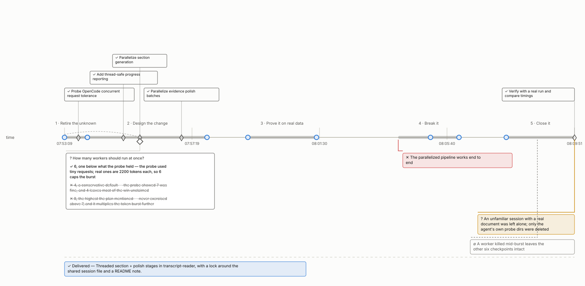

# Parallelizing section summaries

*07:52:22 → 08:11:23 · 37 tool calls · 1 errors · 9 reasoning blocks*

**Key** — ✓ verified (an observation backs it) · ? assumed (nothing tests it) · ✕ contradicted (an observation disagrees) · ∅ unobserved (no evidence either way)

| | |
|---|---|
| **Asked** | “do paralleilization first then” |
| **Goals** | ✓ Probe OpenCode concurrent request tolerance · 07:53:36 ✓ Add thread-safe progress reporting · 07:55:05 ✓ Parallelize section generation · 07:55:37 ✓ Parallelize evidence polish batches · 07:56:59 ✓ Verify with a real run and compare timings · 08:11:01 |
| **Delivered** | Threaded section + polish stages in transcript-reader, with a lock around the shared session file and a README note. |
| **✓ Checked** | Full pipeline on a cloned session (27.8s, 8 sections, 100% coverage) and a cold/warm resume run. Never killed a worker mid-burst. |

*A goal marked ? was claimed done by the agent but not observed here; ∅ was never attempted; ✕ was abandoned or contradicted.*

The probe did its job: the concurrency limit was retired before any code changed, and the thread pool plus a lock landed without drama. The measurement that justifies the worker count came four minutes after the constant was written, and the one real defect surfaced only because the actual pipeline was run on a clone instead of trusting the unit benchmark.

*Time runs left to right; dots on the line held, branches are where the work deviated, diamonds are forks where one option was taken and the others set aside. Full claims and evidence are in the tables below.*

## Decisions, phase by phase

### 1. Retire the unknown

*Why — “it's a 30-second test”*

| | Claim | Evidence |
|---|---|---|
| ✓ | 7 concurrent requests succeed — 2.1s wall versus ~14s serial-equivalent | probe output 07:53:36 |

### 2. Design the change

*Why — “That *will* race if called from worker threads.”*

| | Claim | Evidence |
|---|---|---|
| ✓ | Each section is one HTTP call with no shared state — safe to parallelize | code read of the section loop |
| ✓ | update_meta is a read-modify-write on session.json — a real race once workers call it | code read, then a module lock added at 07:55:05 |
| ? | Workers = 6 for sections, 4 for polish | written at 07:55:37; the token measurement that tests it ran at 07:57:49 — after |
| ✓ | ↳ **chose** 6, one below what the probe held — the probe used tiny requests; real ones are 2200 tokens each, so 6 caps the burst | stated |
| ✕ | ↳ ~~4, a conservative default~~ — the probe showed 7 was fine, and 4 leaves most of the win unclaimed | stated |
| ✕ | ↳ ~~8, the highest the plan mentioned~~ — never exercised above 7, and it multiplies the token burst further | stated |
| ✓ | The burst is 10.2k peak input tokens — comfortable for this provider | measurement 07:58:19 |

### 3. Prove it on real data

*Why (inferred) — a faster loop only counts if the output quality holds, so the benchmark measures points per section as well as wall clock*

| | Claim | Evidence |
|---|---|---|
| ✓ | Same transcript: 76.9s sequential versus 20.5s at 6 workers | A/B benchmark 08:01:14 |
| ✓ | One section produced 2 points instead of 3 — five sequential runs gave 3,3,3,3,2, so it is sampling variance, not the change | falsification run 08:02:34 |

### 4. Break it

*Why — “rather than trusting the unit benchmark”*

| | Claim | Evidence |
|---|---|---|
| ✕ | The parallelized pipeline works end to end | cloned pipeline run failed 08:04:56 |
| ✓ | The worker returns (index, generated); the merge was handed the whole tuple | code read 08:05:08, one-line fix |
| ✓ | Rerun: 27.8s, 8 sections, 18 points, 100% coverage | full pipeline 08:06:04 |

### 5. Close it

*Why (inferred) — checkpoints are what make a killed run cheap, so the warm path has to be shown to still reuse them*

| | Claim | Evidence |
|---|---|---|
| ✓ | Cold run 32.0s, warm run 0.1s — checkpoints are reused | resume test 08:08:38 |
| ? | An unfamiliar session with a real document was left alone; only the agent's own probe dirs were deleted | judgment call; its creation timestamp falls inside this session, so provenance is not provable from the log |
| ∅ | A worker killed mid-burst leaves the other six checkpoints intact | never tested — only cold and warm runs were tried |

## What to carry forward

1. Measure before committing to a number that shows up in the diff. The worker constant was written at 07:55:37; the measurement that justified it ran at 07:57:49. It happened to agree, which is exactly why the ordering is worth remembering. — *Workers = 6 for sections, 4 for polish*
2. A unit-level benchmark does not prove the integration. The only defect in the change was invisible until the real pipeline ran on a clone. — *The parallelized pipeline works end to end*
3. Before calling an intermittent result a regression, re-run the thing that varied. Five sequential runs answering 3,3,3,3,2 turned a suspected defect into a property of the model. — *One section produced 2 points instead of 3*
4. Probe the limit before designing to it. The 30-second concurrency test is the reason the pool landed at 6 with no 429s and no backtracking. — *7 concurrent requests succeed*

## Still open

- No failure-path test: nobody killed a worker mid-burst to prove the surviving checkpoints still resume. The resume test only covers the clean-interruption case.
- The run emitted 1 warning — 'section 6 point 2 spans 00:04:36-00:05:54, outside section 00:03:50-00:05:16' — observed at 08:06:40 and never explained.
