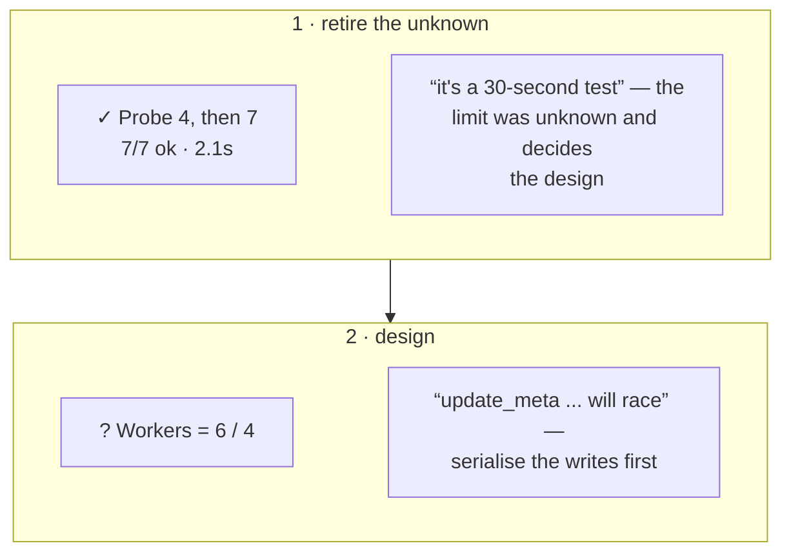
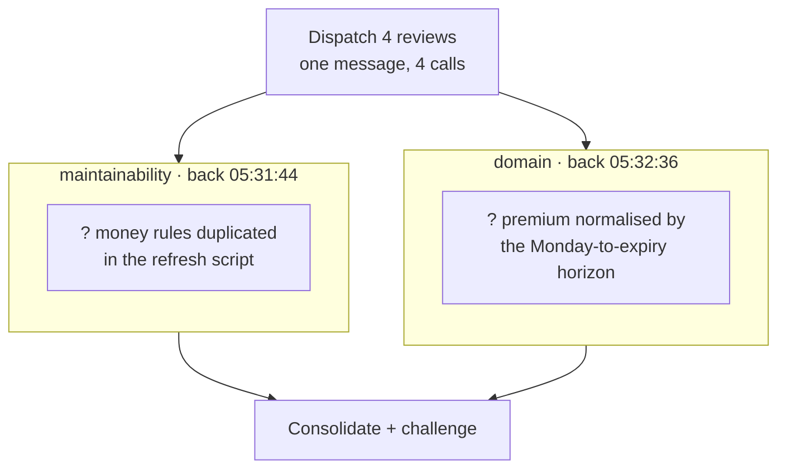

# Work-path colour scheme

**The rule in one line.** Colour encodes one thing only — **how well the log backs the
claim at that node** — because that is the only property every kind of agent work has in
common. It never encodes what kind of activity the node is.

---

## Why this axis and not another

The instinctive scheme (blue = probe, green = edit, red = fail, purple = done) fails the
requirement you set: those words only exist in debugging. A research exchange, a data
analysis, a config change and a support conversation have no "probe" and no "edit", so
the legend would have to be re-invented per problem type — which is exactly the
specificity you want to avoid.

Three axes survive the "always true, whatever the work" test:

| Axis | Universal? | Verdict |
|---|---|---|
| **Epistemic status** — is the claim backed by the log? | Yes. Every step produces a claim; every claim is backed, asserted, contradicted, or unobserved. | **use for colour** |
| Phase / stage | Yes, but the sequence is already spatial | subgraph bands, not colour |
| Node role (question / action / outcome) | Yes | shape, not colour |
| Activity type (probe / edit / run) | No — domain-specific | never |
| Success vs failure | Misses the point: a *failed probe* is a success, an *unverified pass* is a liability | never as an axis |
| Importance / leverage | Yes, but a separate channel | annotation, not colour |

The axis also turns the packet's own worst finding into something you can see. In the
parallelization exchange, `SECTION_WORKERS=6` was **assumed** four minutes before the
measurement that later **verified** it was safe. Those two states are now two different
colours, and their order on the page shows the guess preceded the evidence. No extra
encoding needed — the §3a failure mode is visible for free.

---

## The four states

Each node is **one claim**. Colour answers one question about it: *does the log back
this?*

| State | Glyph | Meaning | Test that assigns it |
|---|---|---|---|
| **Verified** | ✓ | An observation in the log supports the claim. | A tool result, measurement, or code read that says so. |
| **Assumed** | ? | The agent stated or acted on it; nothing in the log tests it. | The claim appears in thinking, plan, or edit, and no later output bears on it. |
| **Contradicted** | ✕ | An observation in the log disagrees with the claim. | Output conflicts with what was asserted — an error, a failed assertion, a wrong number. |
| **Unobserved** | ∅ | No information either way. Includes what was never attempted. | Absence of any output. Rendered dashed. |

**Not every error is Contradicted.** A probe that returns "7 works, 8 doesn't" is
**Verified** — it established a fact. Red is reserved for the moment *reality disagreed
with something the agent believed*: the pipeline that "works" throwing
`'tuple' object has no attribute 'get'`. If red meant "the output contained an error
string", every log would be red and red would stop meaning anything.

**Not every judgment is Contradicted either.** "I kept this session because it wasn't
mine to delete" is a heuristic with no test behind it — **Assumed**, and rendering it
amber is more honest than the packet's own account, which presents it as a clean
judgment call.

**Expected failures are Verified.** If the agent predicted the test would fail and it
did, that is support, not contradiction. The distinction is whether the claim *in the
node* survived.

---

## Colour values

Validated with the dataviz palette checks (categorical, all-pairs, both modes). Node
body is a tint; the stroke carries the hue at full strength; text stays in ink.

### Light mode — surface `#fcfcfb`

| State | Stroke | Fill (12% tint) | Node text | Glyph |
|---|---|---|---|---|
| Verified | `#2a78d6` blue | `#e3ecf7` | `#0b0b0b` | ✓ |
| Assumed | `#c98500` amber | `#f6eedd` | `#0b0b0b` | ? |
| Contradicted | `#d03b3b` red | `#f7e5e4` | `#0b0b0b` | ✕ |
| Unobserved | `#898781` gray, dashed | none | `#52514e` | ∅ |

### Dark mode — surface `#1a1a19`

| State | Stroke | Fill (26% tint) | Node text |
|---|---|---|---|
| Verified | `#3987e5` | `#22364e` | `#f0efec` |
| Assumed | `#c98500` | `#483612` | `#f0efec` |
| Contradicted | `#d03b3b` | `#492322` | `#f0efec` |
| Unobserved | `#898781` dashed | none | `#c3c2b7` |

### What the checks said

- **Blue / amber / red passes both modes, all pairs.** Worst pair light: blue↔red
  ΔE 23.8 (protanopia), normal-vision 28.4. Dark: amber↔red ΔE 10.2 (deuteranopia),
  normal-vision 16.9. All above the floors.
- **Green for "verified" was rejected on measurement, not taste.** The traffic-light
  set (`#0ca30c` green / `#fab219` amber / `#d03b3b` red) collapses to **ΔE 4.1 under
  deuteranopia** — below even the secondary-encoding floor. For the most common form of
  colour blindness, verified and contradicted become the same colour, in a diagram whose
  entire job is telling those two apart.
- **Blue is also the honest choice semantically.** Green means "good". In this artifact
  the contradicted node is often the *most valuable* one — it is where the lesson is.
  A palette that moralises "good/bad" fights the artifact's purpose; blue reads as
  "known" without praise.
- **Amber sits at 2.99:1 on the light surface**, a WARN under the contrast check. The
  relief rule applies: every node carries a visible text label, so the fill never
  carries meaning alone. Do not use amber fill without its label.

---

## Redundancy (required, not optional)

Identity is never colour alone:

1. **Glyph prefix** in every node: `✓ ? ✕ ∅`. Reads in greyscale, prints, and for
   colour-blind readers. This is what makes a repeated legend unnecessary.
2. **Dash pattern**: Unobserved is always dashed; the other three are solid.
3. **Legend once per document** — in the header, never inside each figure. See §The
   legend is a one-time artifact.

---

## The other channels

Colour is now fully spent. Everything else gets its own channel:

| Property | Channel |
|---|---|
| Role: question / decision | **diamond** |
| Role: action or observation | **rectangle** |
| Role: outcome / deliverable | rectangle, bold label |
| Phase | **spatial band** (subgraph), neutral background |
| Phase rationale ("why this phase exists") | **borderless note beside the band**, muted ink |
| Link directly evidenced by the log | **solid arrow** |
| Link inferred by the reviewer | **dashed arrow** |
| Agent instance (who did it) | **lane** — see §Multi-agent |
| User turn or external event | neutral bar, ink only — no hue |
| Waste / antipattern / leverage | **badge or table column** — never a fifth hue |

That last row is deliberate. The counter-example exchange's wasted cycles and the
"process chart deferred" decision are judgments about *efficiency*, not about evidence.
Painting them a colour would overload the only channel that is doing universal work, and
the moment a fifth hue exists, every reader has to hold five meanings in their head to
read one diagram.

---

## The legend is a one-time artifact, not a fixture

You're right that a legend repeated on every diagram is noise once the four states are
familiar. Rules:

- **The legend appears once per document**, in the report header, never inside a figure.
  The first figure of a new series can carry it; nothing after that.
- **The glyph carries the meaning.** `✓ ? ✕ ∅` sit in every node label, so a reader who
  has seen the scheme once needs no key, and a reader who hasn't can still parse the
  figure. This is also what keeps the palette legal without a legend: identity is never
  colour-alone.
- **`agent-work-path-colour-scheme.svg` is that one-time artifact** — keep it as the
  reference sheet, and build every subsequent figure without a legend band.
- Where a document will be read cold (someone else opens it), put the four-state key in
  the **caption or header line in plain text**, not as coloured boxes in the figure:
  `✓ verified · ? assumed · ✕ contradicted · ∅ unobserved`. One line, no visual weight.

---

## Phase rationale, to the side

Each phase band gets one short note explaining **why the phase exists at all** — the
question it was there to retire, or the risk it was there to bound. Not what happened
(the nodes say that), and not a summary (the caption says that).

**Placement.** A borderless, transparent node in the same band, to the right of the
phase's node(s), joined by an invisible link (`~~~`). Muted ink (`#52514e`), no fill, no
stroke. It reads as margin note, visually subordinate to every claim node — which is
correct, because it is commentary, not evidence.

**What it must contain.** The rationale is a claim about intent, so it carries the same
provenance discipline as everything else:

- **Quoted** — the agent said it before acting. Put it in quotation marks and keep it
  short: `"it's a 30-second test" — the limit was unknown and decides the design`.
  Quote the earliest statement: something said *before* the action is evidence; something
  said in the final summary is hindsight.
- **Inferred** — the reviewer reconstructed it. Mark it: `why (inferred) — faster only
  counts if quality holds`. Never dress a reconstruction as a quote; that is the exact
  failure §3(a) of the evidence packet describes.

**Why side placement beats a caption.** A caption at the bottom forces the reader to
hold a phase number in memory and match it back up. Beside the band, the reason is
adjacent to the thing it explains, at zero cognitive cost, and the diagram stays a
single scan.

**Layout note (measured).** With `direction LR` inside each band and an invisible
`~~~` link, mermaid puts the note to the right of the node at the same y (verified:
note at x=320 vs node at x=122, same row). Without the link the note can land left of
the node. Keep the `~~~`.

---

## Multi-agent: lanes, and a stricter rule for what a subagent's word is worth

Multi-agent work is real in your transcripts — 32 `Agent` calls across 7 sessions, and
one exchange dispatched **4 reviewers** then **6 challengers**, all genuinely
concurrent (launched within 5 s, results returning over the next three minutes). So yes,
it needs representing. But it changes almost nothing about the palette, and it changes
one thing about the rules a lot.

**Lanes for agents, not hues.** Each agent gets a **lane** (a subgraph per agent, placed
side by side and fed from one dispatch node, converging on one consolidate node). Colour
stays epistemic status. Concurrency is carried by *topology* — parallel branches that
rejoin — which is the one thing a diagram does better than prose. Never colour by agent
identity: that spends the hue channel on "who", which the lane already says.

**The rule that matters: a subagent's report enters the main trace as Assumed.** The
parent did not observe it. It received a message from another model, and the harness
itself frames it that way ("model output, NOT a message from the user"). So a finding
that a subagent labels "Verified" is still **?** in the parent's diagram until the
parent checks it. In the real exchange this is exactly what happened: four reviewers
returned, the parent ran six challenge agents against their top findings, and two were
**refuted** and four **downgraded**. If the diagram had painted the reviewers' findings
as verified, it would have reproduced the packet's central failure at a bigger scale.

**Subagent internals stay out of the main figure.** One lane node per subagent (its
headline finding or its result), not its whole path. Its transcript exists separately
(`<session>/subagents/agent-<id>.jsonl`) and can be reviewed on its own — same palette,
same rules, a separate figure. Otherwise the main diagram re-becomes a transcript.

**Order lanes by return time, and put the return time in the lane label.** Concurrency
is only legible if the reader can see that lane 3 finished before lane 1 and the parent
acted on partial returns ("maintainability is back; the other three are still running").
That partial-knowledge moment is often the most instructive part of a multi-agent trace
and it disappears if lanes are drawn as a clean fork-join with no timing.

**Contradiction between lanes is a first-class node.** When two agents disagree, the
conflict is not a tie and not a fifth colour: render the *challenged* claim as ✕ once
the parent adjudicates it, and show the adjudication as the node that decided. The
screener exchange's "0 survived, 4 downgraded, 2 refuted" is the single best thing to
put on the page.

---

## Mermaid implementation

```mermaid
%%{init: {"flowchart": {"wrappingWidth": 190, "nodeSpacing": 30, "rankSpacing": 30, "htmlLabels": true}} }%%
flowchart TB
  classDef verified fill:#e3ecf7,stroke:#2a78d6,stroke-width:1.5px,color:#0b0b0b
  classDef assumed fill:#f6eedd,stroke:#c98500,stroke-width:1.5px,color:#0b0b0b
  classDef contradicted fill:#f7e5e4,stroke:#d03b3b,stroke-width:1.5px,color:#0b0b0b
  classDef unobserved fill:#fcfcfb,stroke:#898781,stroke-width:1.5px,stroke-dasharray:5 3,color:#52514e
  classDef decision fill:#fcfcfb,stroke:#52514e,stroke-width:1.5px,color:#0b0b0b
  classDef why fill:transparent,stroke:none,color:#52514e
  classDef neutral fill:#fcfcfb,stroke:#52514e,stroke-width:1.5px,color:#0b0b0b
```

Assign with `class A1,B2 verified` etc. Put the glyph in the label text (`✓ Probe 7
concurrent`), not in CSS.

**Phase band with a side rationale** — note the `~~~` invisible link, which is what keeps
the note to the right of the node rather than below it:



**Lanes for parallel agents** — one subgraph per agent, fan out from a dispatch node,
fan in to a consolidate node. Edges go between *subgraphs* (`D0 --> L1`), so each lane
stays a vertical stack:



Mermaid renders one colour mode per SVG and its PNG export is broken in this environment
(`unknown option '-w'`), so: emit light-mode SVG as the artifact, and keep the dark
values here for whenever the report is embedded in an HTML shell.

---

## Two rules for assigning colour

1. **One node, one claim.** If a node is half-verified and half-guessed, split it. Mixed
   status is not a fifth colour; it's two nodes.
2. **Colour follows the claim, never the tool.** "Ran the test" is not a colour. "The
   test says the fix works" is Verified. "I believe it works" is Assumed.

And a third, for delegated work:

3. **A subagent's finding is Assumed in the parent's figure** until the parent observes
   it. Its own figure can colour it Verified against its own log — different reader,
   different claim.
